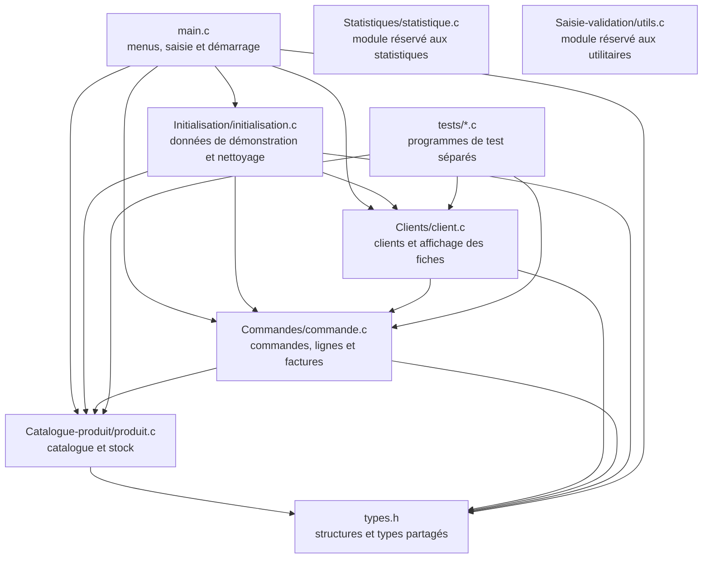
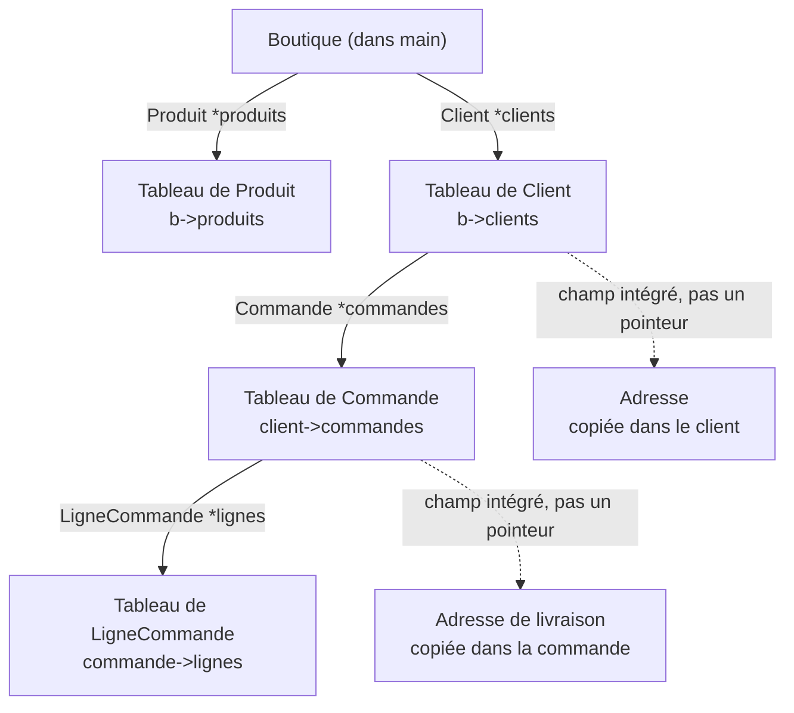
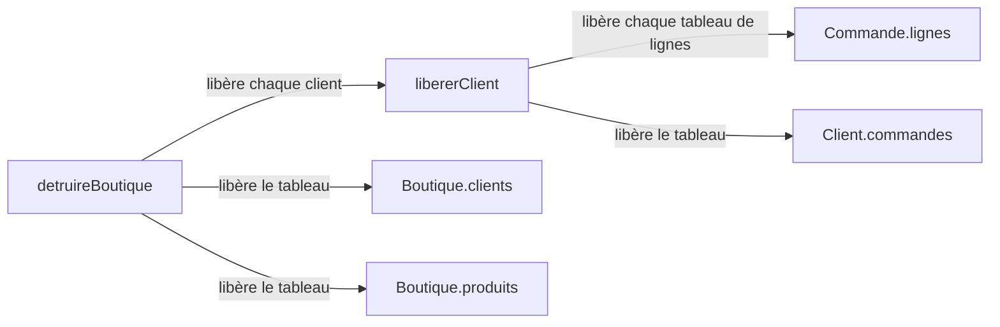
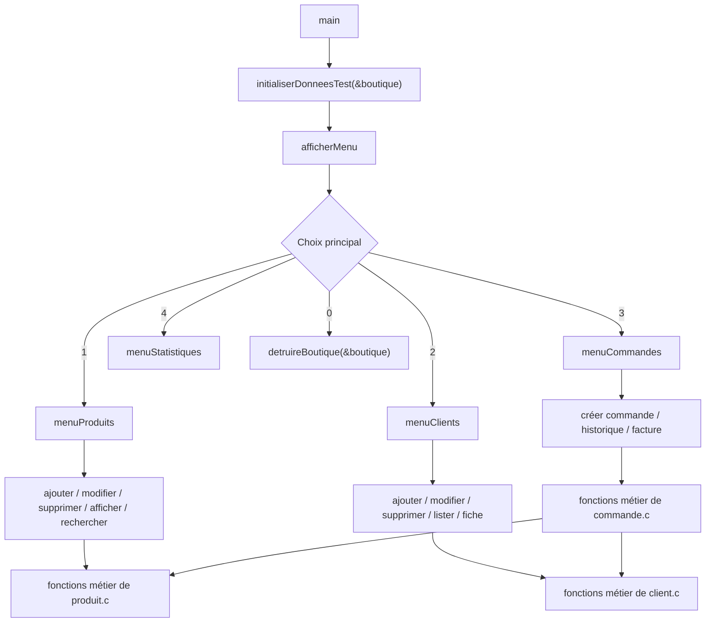
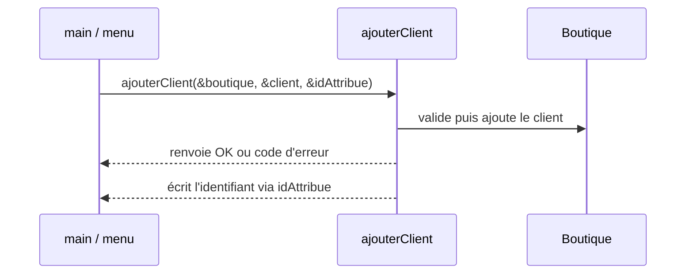

# Comprendre ShopFlow : fichiers, fonctions et pointeurs

Ce document décrit l'organisation actuelle du projet. Il explique où les fonctions sont définies, pourquoi elles sont appelées depuis le menu ou depuis un autre module, et comment les pointeurs relient les données.

## 1. Vue d'ensemble des fichiers



Les fichiers `.h` annoncent les fonctions et types qu'un autre fichier peut utiliser. Les fichiers `.c` contiennent leur code. `types.h` est partagé parce que plusieurs modules manipulent les mêmes objets `Boutique`, `Client`, `Commande` et `Produit`.

## 2. À quoi sert un pointeur ?

Un pointeur contient l'adresse d'une donnée en mémoire. Dans ce projet, les pointeurs servent surtout à partager et modifier la boutique sans copier tout son contenu.

| Écriture C | Sens |
|---|---|
| `Boutique *b` | `b` contient l'adresse d'une `Boutique`. |
| `&boutique` | « adresse de `boutique` » ; on l'envoie à une fonction qui doit la lire ou la modifier. |
| `b->nbClients` | accéder au champ `nbClients` de la boutique pointée par `b` ; équivaut à `(*b).nbClients`. |
| `const Client *c` | pointeur vers un client que cette fonction s'engage à ne pas modifier. |
| `NULL` | pointeur qui ne désigne aucun objet. Il sert notamment à représenter un tableau pas encore alloué. |
| `int *idAttribue` | adresse où une fonction peut écrire un résultat supplémentaire, comme l'identifiant créé. |

Exemple du menu :

```c
Boutique boutique = {0};
initialiserDonneesTest(&boutique);
```

`&boutique` permet à `initialiserDonneesTest` de remplir la variable qui appartient à `main`. Si la fonction recevait seulement `boutique` par valeur, elle travaillerait sur une copie.

## 3. Schéma des données et des pointeurs

Dans `types.h`, une boutique possède deux tableaux dynamiques. Chaque client possède son tableau de commandes, et chaque commande possède son tableau de lignes.



Les flèches pleines représentent des tableaux obtenus avec `malloc` ou `realloc`. Les champs `Adresse` sont stockés directement dans la structure : ils ne demandent pas d'allocation séparée ni de `free`.

### Propriété et libération mémoire



Règle pratique : un tableau dynamique doit être libéré une fois par son propriétaire. `detruireBoutique` commence par les données contenues dans chaque client, puis libère les tableaux de clients et de produits.

## 4. Parcours des appels depuis le menu

Le menu ne réalise pas lui-même toutes les règles métier. Il demande les informations, appelle une fonction métier, puis affiche son résultat.



Les fonctions sont appelées à cet endroit parce que c'est là que l'application sait quel choix la personne a fait. Les menus secondaires traduisent un numéro en action. Les modules (`produit.c`, `client.c`, `commande.c`) réalisent ensuite l'opération sur la boutique.

## 5. Rôle de chaque fichier

### Fichiers partagés et démarrage

| Fichier | Rôle et appels importants |
|---|---|
| [`types.h`](../types.h) | Définit `Boutique`, `Produit`, `Client`, `Commande`, `LigneCommande`, `Adresse`, `Date`, `StatutCommande` et les codes `CodeRetour`. Les champs pointeurs `produits`, `clients`, `commandes` et `lignes` sont les tableaux dynamiques. |
| [`main.c`](../main.c) | Crée `Boutique boutique`, la passe par adresse à `initialiserDonneesTest`, affiche les quatre menus et appelle les fonctions d'interface. Les fonctions interactives reçoivent `Boutique *` pour modifier la boutique réelle. En quittant, appelle `detruireBoutique`. |
| [`Initialisation/initialisation.h`](../Initialisation/initialisation.h) | Déclare l'initialisation et le nettoyage afin que `main.c` puisse les appeler. |
| [`Initialisation/initialisation.c`](../Initialisation/initialisation.c) | Remplit la boutique de démonstration en réutilisant les fonctions d'ajout des modules. `ajouterCommandeDemo` copie les lignes de démonstration dans un tableau alloué pour la commande. `detruireBoutique` orchestre la libération de toute la mémoire. |

### Produits

| Fichier | Rôle et appels importants |
|---|---|
| [`Catalogue-produit/produit.h`](../Catalogue-produit/produit.h) | Déclare la recherche, l'ajout, la modification, la suppression, l'affichage et la recherche textuelle des produits. |
| [`Catalogue-produit/produit.c`](../Catalogue-produit/produit.c) | `ajouterProduit` agrandit le tableau `b->produits` si nécessaire. `trouverProduit` renvoie un indice. `modifierProduit` et `supprimerProduit` retrouvent ensuite le produit. La suppression est logique : elle passe `actif` à faux. `supprimerProduit` parcourt aussi les clients et commandes pour empêcher la suppression d'un produit encore utilisé par une commande active. |

### Clients

| Fichier | Rôle et appels importants |
|---|---|
| [`Clients/client.h`](../Clients/client.h) | Déclare les opérations de gestion et d'affichage des clients. |
| [`Clients/client.c`](../Clients/client.c) | `ajouterClient` valide les champs, agrandit `b->clients` et écrit l'identifiant créé à l'adresse `idAttribue`. `trouverClient` renvoie l'indice du client ou `-1`. `modifierClient` et `supprimerClient` utilisent cet indice. `afficherFicheClient` appelle `afficherHistoriqueCommandes` pour compléter la fiche. `libererClient` libère chaque tableau de lignes, puis le tableau de commandes du client. |

### Commandes et factures

| Fichier | Rôle et appels importants |
|---|---|
| [`Commandes/commande.h`](../Commandes/commande.h) | Déclare les fonctions métier utilisées par le menu, les clients et les tests. |
| [`Commandes/commande.c`](../Commandes/commande.c) | `creerCommande` retrouve le client, agrandit `client->commandes` si besoin, puis écrit le numéro dans `numeroCommande`. `ajouterLigneCommande` retrouve la commande et le produit, vérifie le stock, agrandit `commande->lignes`, puis recalcule les montants. La suppression d'une ligne ou l'annulation remet le stock. `afficherFacture` et `afficherHistoriqueCommandes` ne modifient pas les données : ils prennent des pointeurs `const`. |

### Autres modules

| Fichier | État actuel |
|---|---|
| [`Statistiques/statistique.h`](../Statistiques/statistique.h) et [`Statistiques/statistique.c`](../Statistiques/statistique.c) | Emplacement prévu pour les fonctions statistiques. Pour l'instant, les deux actions disponibles du menu (chiffre d'affaires global et alertes de stock) sont calculées directement dans `main.c`. |
| [`Saisie-validation/utils.h`](../Saisie-validation/utils.h) et [`Saisie-validation/utils.c`](../Saisie-validation/utils.c) | Emplacement prévu pour les fonctions de saisie/validation partagées. La saisie du menu actuel est dans `main.c`. |

### Tests

| Fichier | Ce qu'il vérifie |
|---|---|
| [`tests/test_produit.c`](../tests/test_produit.c) | Le module catalogue. |
| [`tests/test_client_creation.c`](../tests/test_client_creation.c) | La création et les règles du module clients, avec les données et commandes nécessaires. |
| [`tests/test_commande_facturation.c`](../tests/test_commande_facturation.c) | Les commandes, leurs lignes et les montants de facture. |

Chaque programme de test a son propre `main`. Il ne faut donc pas les ajouter à la compilation de l'application principale.

## 6. Pourquoi les fonctions se passent des pointeurs ?

### Modifier la boutique

```c
ajouterProduit(&boutique, &produit);
```

`&boutique` donne à `ajouterProduit` accès au tableau et aux compteurs de la vraie boutique. `&produit` transmet le produit à copier. Le paramètre est `const Produit *` car la fonction copie les informations sans modifier la variable de saisie.

### Renvoyer deux résultats

Une fonction C ne renvoie qu'une valeur avec `return`. Pour renvoyer le code de succès et aussi l'identifiant créé, `ajouterClient` reçoit `int *idAttribue`. Elle écrit à cet emplacement, puis renvoie `OK` ou un code d'erreur.



### Agrandir un tableau sans perdre l'ancien

Les tableaux changent de taille grâce à `realloc`. Le résultat est d'abord placé dans un pointeur temporaire :

```c
Produit *nouveauTableau = realloc(boutique->produits,
                                  nouvelleCapacite * sizeof *nouveauTableau);
if (nouveauTableau != NULL)
    boutique->produits = nouveauTableau;
```

Si `realloc` échoue, le pointeur original reste valide. Si elle réussit, le tableau peut avoir changé d'adresse : le champ propriétaire est alors mis à jour.

> **Attention :** après un `realloc`, ne réutilise pas un pointeur vers un élément de l'ancien tableau. Garde plutôt son indice puis récupère l'adresse depuis le nouveau tableau.

## 7. Ordre d'exécution au lancement

1. `main` met `boutique` à zéro (`{0}`), donc les pointeurs commencent à `NULL` et les compteurs à zéro.
2. `initialiserDonneesTest(&boutique)` ajoute les produits et les clients, puis crée les commandes de démonstration.
3. Chaque choix du menu appelle une fonction avec `&boutique`.
4. Quand la personne choisit `0`, `detruireBoutique(&boutique)` libère les tableaux alloués.

La compilation de l'application (depuis la racine du dépôt sous WSL) est :

```bash
mkdir -p build
gcc -std=c11 -Wall -Wextra -Wpedantic -Werror -g \
  -I . -I Catalogue-produit -I Clients -I Commandes \
  -I Statistiques -I Saisie-validation -I Initialisation \
  main.c Catalogue-produit/produit.c Clients/client.c \
  Commandes/commande.c Statistiques/statistique.c \
  Saisie-validation/utils.c Initialisation/initialisation.c \
  -o build/shopflow
./build/shopflow
```
